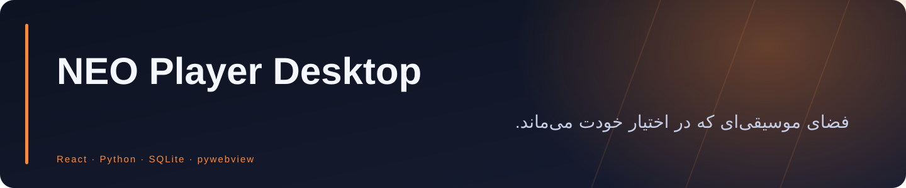
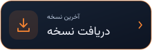
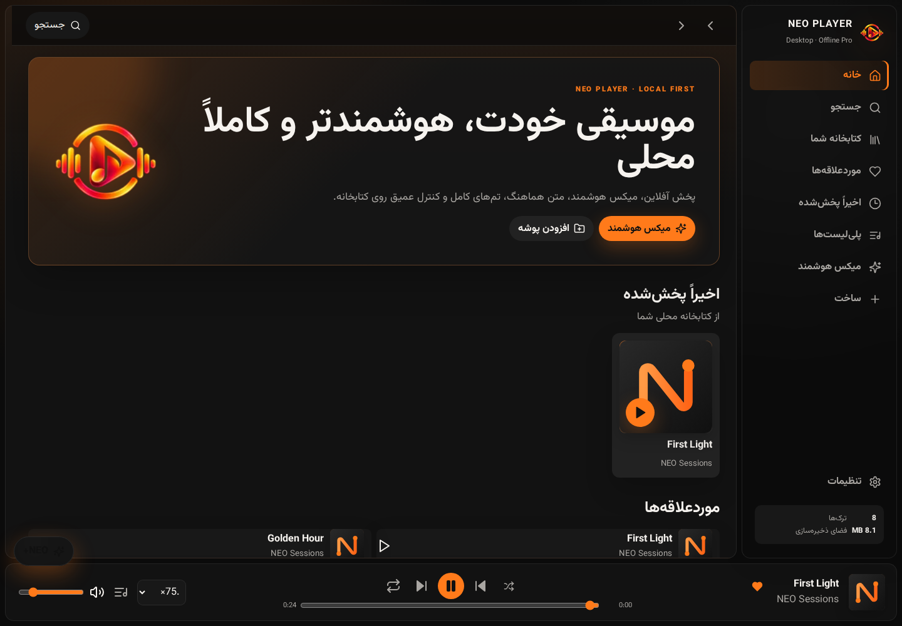
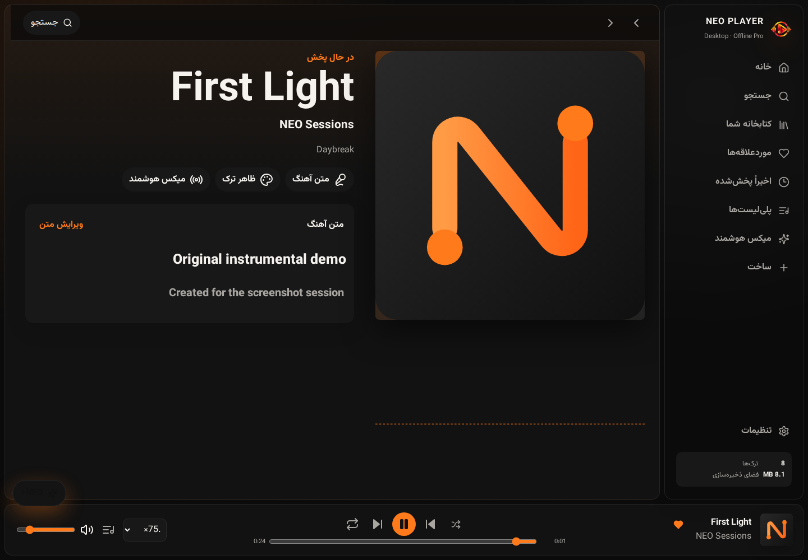
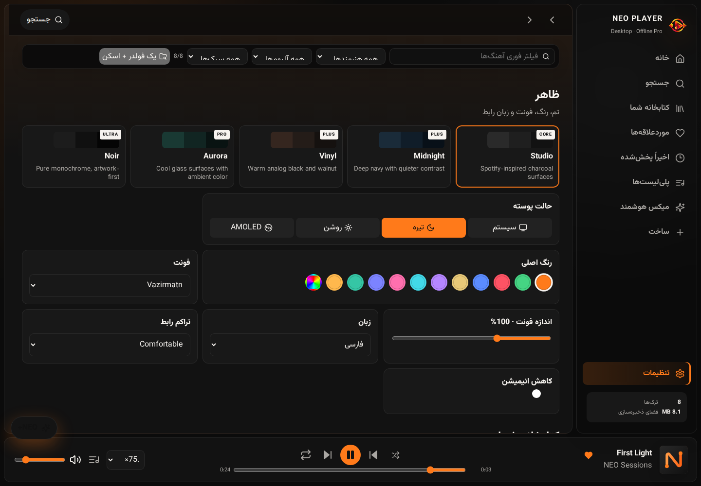

<div align="center">



**پخش‌کنندهٔ موسیقی ویندوز با کتابخانهٔ محلی مبتنی بر Python، میکس هوشمند، متن هماهنگ آهنگ و پوسته‌های قابل شخصی‌سازی.**


<a href="https://github.com/Realjustawall/neo-player-desktop/actions/workflows/quality.yml"></a>

<a href="https://github.com/Realjustawall/neo-player-desktop/releases/latest"></a>
<a href="docs/gallery.fa.md"></a>
<a href="#quick-start"></a>
<a href="https://github.com/Realjustawall/neo-player-desktop/issues"></a>

[English](README.md) · [فارسی](README.fa.md)

</div>

---

[قابلیت‌های شاخص](#features) · [پیش‌نمایش](#preview) · [راه‌اندازی](#quick-start) · [توسعه](#development) · [مستندات](#documentation) · [امنیت و حریم خصوصی](#security) · [مجوز و بازخورد](#license)

<a id="features"></a>

## قابلیت‌های شاخص

| قابلیت | کاربرد |
|---|---|
| مجموعهٔ موسیقی | اسکن پوشه یا سیستم، فرمت‌های محلی، موردعلاقه‌ها، پلی‌لیست و پوشه‌های تودرتو. |
| پخش دلخواه | صف، پخش تصادفی، تکرار، سرعت پخش، کراس‌فید و میکس هوشمند محلی. |
| شخصی‌سازی | پنج پیش‌تنظیم ظاهری، حالت روشن، تیره، سیستم و AMOLED، رنگ دلخواه و رابط راست‌به‌چپ فارسی. |
| متن و تصویر | LRC هماهنگ، لایه‌های ترجمه و آوانویسی، کاور آهنگ و ویژوالایزر. |
| هوش مصنوعی اختیاری | دریافت جداگانهٔ موتور Lyrics AI و مدل‌های Whisper پس از رضایت اولیهٔ کاربر. |
| کنترل محلی | ذخیره‌سازی SQLite، پشتیبان و بازیابی، مدیریت حافظهٔ موقت و کارکرد بدون حساب. |

<a id="preview"></a>

## پیش‌نمایش

رابط اصلی همراه بک‌اند Python/SQLite در میزبان مرورگر روی لینوکس ثبت شده است؛ این تصاویر اجرای EXE ویندوز نیستند. صدا و متن آهنگ، نمونه‌اند.



<details>
<summary>تصاویر بیشتر</summary>





</details>

[مشاهدهٔ گالری کامل](docs/gallery.fa.md)

<a id="quick-start"></a>

## راه‌اندازی

۱. **NEO-Player-Setup.exe** یا بستهٔ قابل‌حمل را از ریلیز دریافت کنید.
۲. برنامه را نصب کنید یا بستهٔ قابل‌حمل را به‌طور کامل استخراج کنید.
۳. پوشهٔ موسیقی را اضافه کنید، کتابخانه را اسکن کنید و پوستهٔ دلخواه را انتخاب کنید.
۴. برای دریافت اختیاری موتور و مدل‌های Lyrics AI، بخش NEO+ را باز کنید.

موتور هوش مصنوعی جداگانه منتشر می‌شود. موسیقی، پلی‌لیست، تنظیمات، تحلیل و متن آهنگ روی دستگاه می‌مانند.

<a id="development"></a>

## توسعه

Node.js و npm و Python 3.12؛ میزبان بومی دسکتاپ را روی ویندوز اجرا کنید.

```powershell
git clone https://github.com/Realjustawall/neo-player-desktop.git
cd neo-player-desktop
npm ci
npm run build
python -m pip install -r requirements.txt
python python/desktop.py
```

دستورهای بررسی:

```powershell
python -m unittest discover -s tests -v
python python/desktop.py --self-test
python python/desktop.py --ui-smoke
```

بسته‌بندی ریلیز ویندوز:

```powershell
./scripts/build-windows.ps1
```

<a id="documentation"></a>

## مستندات

- [مرجع کامل قابلیت‌ها](REFERENCE.md)
- [بسته‌بندی ویندوز](scripts/build-windows.ps1)
- [بک‌اند Python](python/backend.py)

<a id="security"></a>

## امنیت و حریم خصوصی

کتابخانه و وضعیت کاربر محلی‌اند. استریم، دریافت مدل و آماده‌سازی اختیاری Lyrics AI در صورت درخواست به شبکه دسترسی دارند. ساخت حساب لازم نیست. فایل مجوز در ریشهٔ این مخزن وجود ندارد؛ عمومی بودن سورس به‌تنهایی مجوز بازتوزیع نیست.

<a id="license"></a>

## مجوز و بازخورد

فایل مجوز در ریشهٔ مخزن ارائه نشده است. پیش از بازتوزیع یا استفادهٔ مجدد با نگهدارنده هماهنگ کنید.

[گزارش اشکال و پیشنهاد بهبود](https://github.com/Realjustawall/neo-player-desktop/issues). نسخه، سیستم‌عامل و روش بازتولید را بنویسید و اطلاعات خصوصی یا رمزها را در گزارش قرار ندهید.

---

نگهداری توسط **[Realjustawall](https://github.com/Realjustawall)**.
