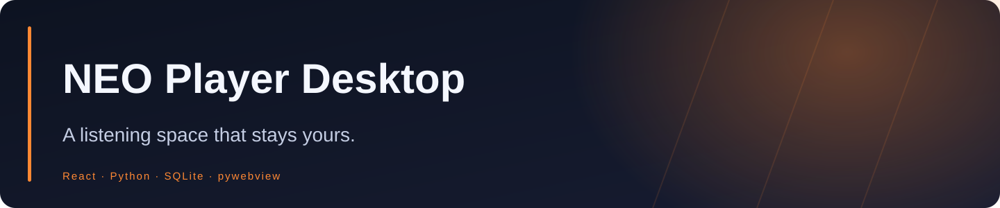
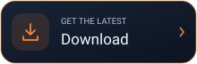
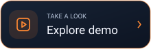
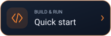
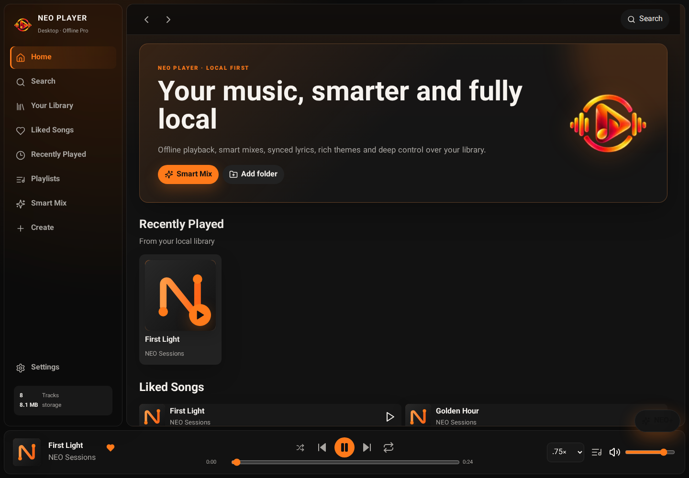
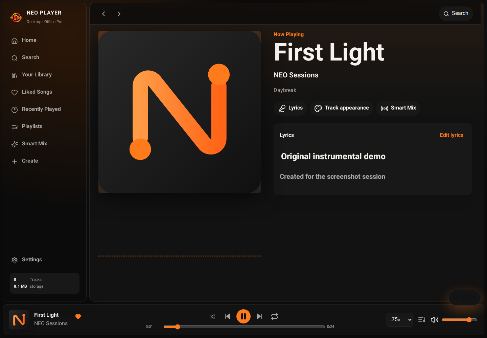
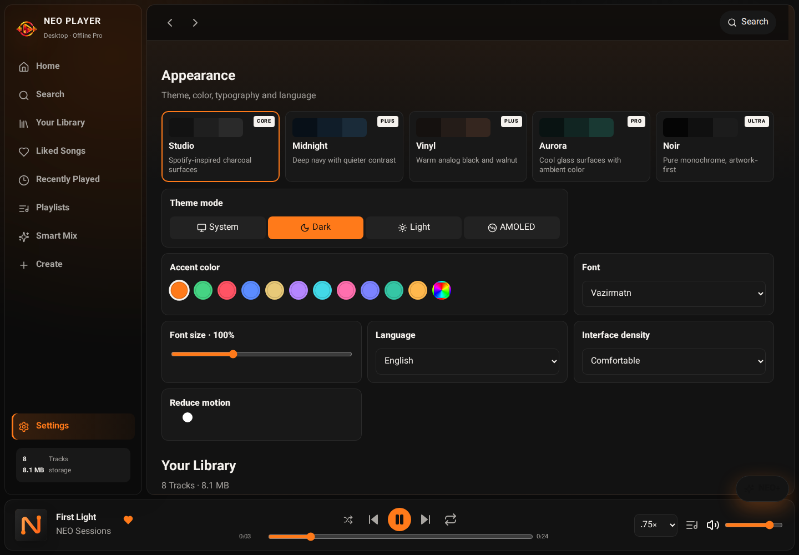

<div align="center">



**A local-first Windows music player with smart mixes, synchronized lyrics, expressive themes and a Python-backed library.**


<a href="https://github.com/Realjustawall/neo-player-desktop/actions/workflows/quality.yml"></a>

<a href="https://github.com/Realjustawall/neo-player-desktop/releases/latest"></a>
<a href="docs/gallery.en.md"></a>
<a href="#quick-start"></a>
<a href="https://github.com/Realjustawall/neo-player-desktop/issues"></a>

[English](README.md) · [فارسی](README.fa.md)

</div>

---

[Highlights](#features) · [Preview](#preview) · [Quick start](#quick-start) · [Development](#development) · [Documentation](#documentation) · [Security and privacy](#security) · [License and feedback](#license)

<a id="features"></a>

## Highlights

| Capability | What you get |
|---|---|
| Your collection | Folder/system scanning, local formats, favorites, playlists and nested folders. |
| Listen your way | Queue, shuffle, repeat, playback speed, crossfade and smart local mixes. |
| Make it yours | Five visual presets, light/dark/system/AMOLED modes, accents and Persian RTL. |
| Lyrics and visuals | Synchronized LRC, translation/romanization layers, per-track covers and visualizers. |
| Optional AI | Separately downloaded Lyrics AI runtime and Whisper models after first-use consent. |
| Local control | SQLite persistence, backup/restore, cache controls and no account requirement. |

<a id="preview"></a>

## Preview

The real app interface with its Python/SQLite backend, captured in a browser host on Linux; these are not Windows EXE captures. Audio and lyrics are demo content.



<details>
<summary>More screens</summary>





</details>

[Open the full gallery](docs/gallery.en.md)

<a id="quick-start"></a>

## Quick start

1. Download **NEO-Player-Setup.exe** or the portable ZIP from Releases.
2. Install the application, or extract the portable package completely.
3. Add a music folder, scan your library and choose a theme.
4. Open NEO+ when you want the optional Lyrics AI runtime and model downloads.

The AI runtime is distributed separately. Your music, playlists, settings, analysis and lyrics stay local.

<a id="development"></a>

## Development

Node.js/npm and Python 3.12. Run the native desktop host on Windows.

```powershell
git clone https://github.com/Realjustawall/neo-player-desktop.git
cd neo-player-desktop
npm ci
npm run build
python -m pip install -r requirements.txt
python python/desktop.py
```

Validation commands:

```powershell
python -m unittest discover -s tests -v
python python/desktop.py --self-test
python python/desktop.py --ui-smoke
```

Windows release packaging:

```powershell
./scripts/build-windows.ps1
```

<a id="documentation"></a>

## Documentation

- [Complete feature reference](REFERENCE.md)
- [Windows packaging](scripts/build-windows.ps1)
- [Python backend](python/backend.py)

<a id="security"></a>

## Security and privacy

The library and user state are local. Optional streams, model downloads and Lyrics AI preparation can access the network when requested. No account is required. A repository-level license file is not currently provided; do not infer redistribution rights from public source availability.

<a id="license"></a>

## License and feedback

No repository-level license file is currently provided. Contact the maintainer before redistribution or reuse.

[Report bugs or discuss improvements](https://github.com/Realjustawall/neo-player-desktop/issues). Include your version, OS and reproducible steps; keep credentials and private data out of reports.

---

Maintained by **[Realjustawall](https://github.com/Realjustawall)**.
